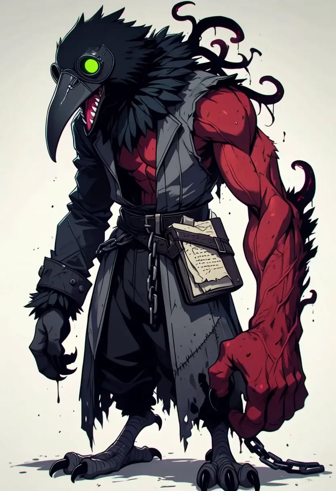

# Krek: idle loop

Krek, one of my Voyage characters (a kenku villain in a plague doctor mask), as a seamless idle loop: he turns
his head round to look at you, his giant red arm swings up across his belly, the tentacles and feathers keep moving,
then he turns back to where he started. Made locally with LTX-2.5 (first and last frame both the portrait, prompted
as a video game idle animation), then the tail blended into the first frame so the wrap doesn't pop.

Files:
- `krek-loop-4s.webp`: the loop, 832x1216, 24 fps (exactly 4.0 s), loops forever, 4.58 MB
- `krek-loop-4s.mp4`: the same loop at 48 fps
- `krek-raw-4s-with-audio.mp4`: the untouched render with its wind and chain sound (not looped)
- `krek-source.png`: the portrait it starts and ends on (832x1216)
